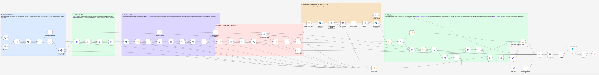
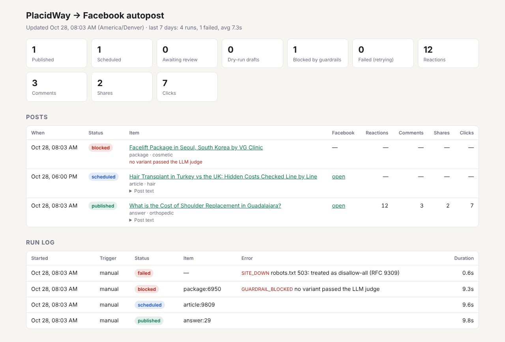

# PlacidWay → Facebook: daily, on-brand, guard-railed posts with n8n

A production-minded n8n automation that, once a day, picks one fresh piece of public PlacidWay content (an article, a treatment package or a patient Q&A answer), writes a Facebook post for it with an LLM, **verifies every claim against the source page**, and then publishes or schedules it on a test Facebook Page, optionally after a human approves it in Telegram. Every run is logged, nothing is ever posted twice, and every failure ends in an alert.

| | |
|---|---|
| **Platform** | n8n 2.45 (self-hosted, Docker), Postgres 16, external task runner |
| **Workflows** | [`workflows/01-placidway-daily-facebook-post.json`](workflows/01-placidway-daily-facebook-post.json) (main, 62 nodes) · [`02-…-engagement-sync.json`](workflows/02-placidway-engagement-sync.json) · [`03-…-dashboard.json`](workflows/03-placidway-dashboard.json) |
| **Safe by default** | `PW_DRY_RUN=true` (simulation) and approval mode available; posts only to a Page you own |
| **Verified** | 37 unit/SQL tests + 15 end-to-end scenarios executed inside a real n8n 2.45.5 instance (see [docs/TESTING.md](docs/TESTING.md)) |
| **Demo recording** | [demo/PlacidWay-demo-recording.mp4](demo/PlacidWay-demo-recording.mp4) (6:51, captioned) |
| **Deliverables** | Workflow JSON · this README · [sample posts from real pages](samples/sample-posts.md) · [recording script](docs/recording-script.md) · [design decisions](docs/DECISIONS.md) |

---

## Contents
1. [Requirements → implementation](#1-requirements--implementation)
2. [Quick start](#2-quick-start-10-minutes)
3. [Configuration (environment variables)](#3-configuration)
4. [How to run](#4-how-to-run)
5. [Architecture](#5-architecture)
6. [Extraction: method and justification](#6-extraction-method-and-justification)
7. [Selection, de-duplication and variety](#7-selection-de-duplication-and-variety)
8. [Generation and guardrails](#8-generation-and-guardrails)
9. [Publishing, approval mode and images](#9-publishing-approval-mode-and-images)
10. [Logging, retries and alerts](#10-logging-retries-and-alerts)
11. [Stretch goals](#11-stretch-goals)
12. [Testing](#12-testing)
13. [Repository layout](#13-repository-layout)
14. [Limits, trade-offs and next steps](#14-limits-trade-offs-and-next-steps)

---

## 1. Requirements → implementation

| Requirement | How it is met |
|---|---|
| **Trigger** daily + manual | Schedule Trigger `0 9,11,14 * * *` (workflow timezone). 09:00 is the post; 11:00 and 14:00 are *self-healing retry slots* that exit immediately once today's post exists. A Manual Trigger always runs (demos/tests). |
| **Extract** title, URL, summary/body, image | `robots.txt` → the three PlacidWay listing pages sorted by *modified date* (articles, packages, Q&A) → detail page. Title/summary/image come from Open Graph tags; body from main-content blocks; package price from product meta. Method justified in [§6](#6-extraction-method-and-justification). |
| **Respect robots.txt, ≤ 1 req/s** | RFC 9309 parser enforced before any request; ~6 requests per run, ≥ 1.5 s apart (measured in the e2e test), honest `User-Agent`, honours `Crawl-delay`. |
| **Select** one item, never the same URL twice | Postgres `pw_posts` keyed by `content_key` (`article:4617`, from the URL's numeric id, so slug/subdomain/query changes cannot fool it) + `UNIQUE(url)`. Item is **claimed atomically** before generation, so even two concurrent runs cannot post the same thing. |
| **Generate** hook, 2–4 lines, CTA, link, 3–5 hashtags, < 500 chars before link | LLM returns *structured JSON parts* (best-of-3 variants); the post is **assembled by code**, so format, link placement and length are guaranteed, not hoped for. |
| **Guardrails** no medical claims, outcomes, invented prices/facts | Two independent layers, fail-closed: deterministic rules (banned-claims lexicon, every number/price must exist in the source, credentials, cited-evidence check) **and** an LLM judge that verifies each claim against the page. Publish only if both pass. [§8](#8-generation-and-guardrails) |
| **Publish** to a test Page, with image; or schedule | Graph API `/{page}/photos` (image + caption) with automatic fallback to `/{page}/feed` (link preview) if Facebook rejects the image. `PW_PUBLISH_STRATEGY=schedule` creates a native Facebook scheduled post. `PW_DRY_RUN=true` simulates and logs the exact request. |
| **Review option** auto vs approval | `PW_REVIEW_MODE=approval` sends the draft + guardrail evidence to Telegram with signed Approve/Reject links; the execution pauses (Wait node) until a decision or timeout. |
| **Logging** item, text, FB post id, status | `pw_run_log` (one row per execution: item, post text, FB post id, status, error code, duration, guardrail report, token usage) + `pw_posts` (state of every item). Also visible in the dashboard. |
| **Errors** retry sensibly, alert, never silent | Node-level retries with backoff where requests are idempotent, run-level retry slots, per-item retry budget, error classification (`SITE_DOWN`, `FB_TOKEN_EXPIRED`, `LLM_AUTH`, …) with a fix-it hint in a Telegram alert, and the workflow is its own Error Workflow for anything unexpected. [§10](#10-logging-retries-and-alerts) |
| **Stretch** | ✅ variety rules · ✅ image handling (1200×630 rendition, validation, fallback) · ✅ Instagram cross-post · ✅ dashboard · ✅ engagement read-back. [§11](#11-stretch-goals) |

---

## 2. Quick start (≈10 minutes)

**Prerequisites:** Docker + Docker Compose, an OpenAI-compatible API key, a Telegram bot (for alerts/approvals), and, for live posting, a Facebook Page you own ([docs/facebook-setup.md](docs/facebook-setup.md)).

```bash
git clone <this repo> placidway-autopost && cd placidway-autopost
cp .env.example .env                    # run configuration + infra passwords
cp .env.secrets.example .env.secrets    # LLM key, Facebook Page token, Telegram bot token
# edit both files (at minimum: passwords/keys, PW_TELEGRAM_CHAT_ID, PW_FB_PAGE_ID for live posting)
./scripts/bootstrap.sh
```

`bootstrap.sh` starts Postgres + n8n + the task runner, creates the database schema, creates the four n8n credentials (encrypted at rest), imports the three workflows with fixed IDs (so credential references resolve automatically) and activates them. Open `http://localhost:5678`, create the owner account, open **“PlacidWay → Facebook: daily post”** and click **Execute workflow**.

<details>
<summary><b>Manual setup without the script (any n8n ≥ 2.x, incl. n8n Cloud)</b></summary>

1. Create a Postgres database and run [`db/init/01-schema.sql`](db/init/01-schema.sql).
2. In n8n create four credentials (names matter only for readability; the IDs in the JSON are just pre-wired):
   | Credential type | Name | Values |
   |---|---|---|
   | Postgres | PlacidWay Postgres | host, db `placidway`, user, password |
   | Header Auth | LLM API key (Bearer) | Name `Authorization`, Value `Bearer sk-…` |
   | Query Auth | Facebook Page token | Name `access_token`, Value `<long-lived Page token>` |
   | Telegram API | Telegram alerts bot | Access token from @BotFather |
3. Import the three files from `workflows/` (*Workflows → Import from file*). Open each red-flagged node once and select the matching credential.
4. Set the `PW_*` variables from `.env.example` in the n8n environment (or edit `OVERRIDES` at the top of the **Config** node), and set `N8N_BLOCK_ENV_ACCESS_IN_NODE=false`.
5. In the daily workflow: *Settings → Error workflow →* select the workflow itself (it contains its own Error Trigger). Activate the three workflows.
</details>

---

## 3. Configuration

All behaviour is controlled by `PW_*` environment variables read by the **Config** node (validated; an invalid value fails the run with `CONFIG_INVALID` and a clear message). Secrets are **never** in env vars, workflow JSON or logs: they live only in n8n's encrypted credential store.

| Variable | Default | Purpose |
|---|---|---|
| `PW_DRY_RUN` | `true` | Simulation: full pipeline, logs the exact Graph API request, posts nothing. |
| `PW_REVIEW_MODE` | `auto` | `auto` publishes directly; `approval` sends the draft to Telegram and waits for a human. |
| `PW_PUBLISH_STRATEGY` | `now` | `now` or `schedule` (Facebook scheduled post at `PW_SCHEDULE_TIME`). |
| `PW_SCHEDULE_TIME` | `18:00` | Local time used for scheduled posts (next occurrence ≥ 15 min ahead, DST-aware). |
| `PW_TIMEZONE` | `America/Denver` | Defines "today" for the one-post-per-day rule and scheduling. Keep `GENERIC_TIMEZONE` equal. |
| `PW_POST_FORMAT` | `photo` | `photo` (image + caption, falls back to link) or `link` (link-preview post). |
| `PW_FB_PAGE_ID` | – | Your **test** Page id. Required when `PW_DRY_RUN=false`. |
| `PW_FB_GRAPH_VERSION` | `v23.0` | Graph API version. |
| `PW_IG_USER_ID` | – | Optional Instagram professional account linked to the Page → cross-post. |
| `PW_LLM_BASE_URL` | `https://api.openai.com/v1` | Any OpenAI-compatible `/chat/completions` endpoint. |
| `PW_LLM_MODEL` / `PW_LLM_JUDGE_MODEL` | `gpt-4.1-mini` / same | Writer and compliance-judge models (a different judge model reduces self-agreement bias). |
| `PW_VARIANTS` | `3` | Best-of-N variants per run (1–5). |
| `PW_TELEGRAM_CHAT_ID` | – | Where drafts, alerts and notifications go. Required in approval mode. |
| `PW_NOTIFY_ON_SUCCESS` | `true` | Also notify on successful posts (failures always alert). |
| `PW_REVIEW_TIMEOUT_HOURS` | `20` | After this, an unreviewed draft expires (`review_expired`, nothing posted). |
| `PW_USER_AGENT` | `PlacidWayContentDemoBot/1.0 (+contact…)` | Honest crawler identity. Put your contact in it. |
| `PW_REQUEST_INTERVAL_MS` | `1500` | Gap between PlacidWay requests (min 1000; `Crawl-delay` wins if larger). |
| `PW_ROTATION` | `article,package,answer,article,package,answer,article` | Preferred content type Mon→Sun (`any` allowed). |
| `PW_MAX_ATTEMPTS` | `3` | How many runs may retry an item that failed for a transient reason. |
| `PW_DISCLAIMER` | `General information only, not medical advice.` | Appended after the hashtags (empty string disables). |

Infrastructure variables (`POSTGRES_*`, `N8N_ENCRYPTION_KEY`, `N8N_RUNNERS_AUTH_TOKEN`, `WEBHOOK_URL`) are documented in [`.env.example`](.env.example).

---

## 4. How to run

| Goal | How |
|---|---|
| **Demo / test run** | Open the daily workflow → **Execute workflow**. Manual runs always proceed (they ignore "already posted today"). |
| **Daily automation** | Activate the workflow. It fires at 09:00, 11:00, 14:00 (workflow timezone); the first successful slot posts, the others exit as `skipped`. |
| **Simulation** | `PW_DRY_RUN=true`. Everything runs except the POST; the run log and Telegram show exactly what would be sent. |
| **Live posting** | `PW_DRY_RUN=false` + `PW_FB_PAGE_ID` + Page token credential. |
| **Human approval** | `PW_REVIEW_MODE=approval` + `PW_TELEGRAM_CHAT_ID` + a `WEBHOOK_URL` reachable from the reviewer's phone (e.g. Cloudflare Tunnel/ngrok in local setups). |
| **Scheduled posts** | `PW_PUBLISH_STRATEGY=schedule`, `PW_SCHEDULE_TIME=18:00`. |
| **Dashboard** | `http://localhost:5678/webhook/placidway-dashboard` |
| **Engagement numbers** | Workflow 02 runs every 6 h (or manually). |

After changing `.env`: `docker compose up -d` (recreates n8n with the new values).

---

## 5. Architecture

```mermaid
flowchart LR
  subgraph T[1 · Trigger & guard]
    S[Schedule 09/11/14] --> C[Config<br/>PW_* validated]
    M[Manual run] --> C
    C --> G{Posted today?}
    G -- no / manual --> P{Dry run?}
    P -- live --> PF[Facebook token<br/>preflight]
  end
  subgraph E[2 · Extract, polite]
    R[robots.txt<br/>RFC 9309] --> L[3 listing pages<br/>≥1.5 s apart]
    L --> H[(pw_posts<br/>history)]
  end
  subgraph SEL[3 · Select]
    H --> SC[Score: rotation +<br/>freshness − repeat category] --> D[Top 2 detail pages] --> X[Extract & validate] --> CL[(Atomic claim)]
  end
  subgraph GEN[4 · Generate + guardrails]
    CL --> LLM[LLM: 3 JSON variants] --> RU[Layer 1: rules] --> J[Layer 2: LLM judge] --> DEC{Both pass?}
  end
  subgraph PUB[5-6 · Review & publish]
    DEC -- yes --> AP{Approval mode?}
    AP -- yes --> TG[Telegram draft<br/>Approve / Reject] --> W[Wait for click]
    W --> FB
    AP -- no --> FB[Facebook photo post<br/>→ link fallback<br/>→ optional Instagram]
  end
  P -- dry --> R
  PF --> R
  DEC -- no --> OUT
  FB --> OUT[7 · Outcome → pw_run_log<br/>→ Telegram → raise if failed]
  ERR[Error Trigger<br/>unexpected crashes] --> OUT
```





**Design principles**

- **One exit for every run.** Every branch (success, skipped, no content, blocked, rejected, failed, crashed) produces an *Outcome* object that flows through the same tail: `DB: finalize run` → `Notify?` → Telegram → `Raise error?`. A new branch cannot forget to log or alert.
- **Fail closed.** Missing judge output, unparseable LLM output, missing evidence → nothing is published.
- **Idempotent and race-safe.** The atomic claim (`INSERT … ON CONFLICT … WHERE status='failed'`) is the single source of truth for "already used". The Facebook POST is deliberately *not* auto-retried (it is not idempotent; a timeout after success would double-post).
- **Tested code = shipped code.** Code-node logic lives in [`src/lib`](src/lib) as plain, dependency-free JS with unit tests; [`scripts/build-workflows.js`](scripts/build-workflows.js) inlines it into the Code nodes and syntax-checks every node. The JSON in `workflows/` is a build artifact, but it is committed and fully self-contained (no external modules, works in n8n's sandbox; e.g. the sandbox has no `URL` global, so a small parser is included).
- **Self-documenting canvas.** Seven sticky notes explain each stage in the editor.

**Data model** ([`db/init/01-schema.sql`](db/init/01-schema.sql))

| Table | One row per | Key columns |
|---|---|---|
| `pw_posts` | content item ever touched | `content_key` (unique), `url` (unique), `status` (`processing → pending_review → approved → published/scheduled`, or `dry_run/blocked/rejected/review_expired/failed`), `attempts`, `post_text`, `guardrail_report`, `fb_post_id`, `fb_permalink`, engagement counters |
| `pw_run_log` | execution | `execution_id`, trigger, mode, `status`, `content_key`, `post_text`, `fb_post_id`, `error_code`, `error_message`, `details` (selection reasoning, guardrail report, token usage, review decision), `duration_ms` |
| `pw_engagement_snapshots` | engagement sync per post | reactions, comments, shares, clicks over time |

All SQL takes a single base64-encoded JSON parameter decoded inside Postgres: values with commas, quotes or emoji can never break the query or inject SQL, and the queries behave the same on every Postgres-node version (older versions split "Query Parameters" on commas).

---

## 6. Extraction: method and justification

| Option | Verdict |
|---|---|
| RSS | No RSS/Atom feed is linked for articles, packages or answers (the only feed linked from the site is the podcast's, hosted on rss.com). |
| Sitemaps | The sitemap pages linked from the site (`/sitemap_article`, `/sitemap_package`, …) are **HTML lists of 1,000+ entries without `lastmod`**: heavy to fetch and they cannot tell us what is new. |
| Headless browser | Not needed: pages are server-rendered (content and Open Graph tags are in the initial HTML). A browser would add ~10× the cost, a Chromium dependency and more load on the site. |
| **Listing pages + HTML parsing (chosen)** | `/search-medical-articles/All/All/1`, `/search-medical-packages/All/All/1`, `/search-medical-answers/All/All/1` are ordered by *modified date*, i.e. they behave like feeds: **one request per content type** returns the freshest items. |

**How parsing stays robust**

- Listing links are recognised by **URL pattern** (`/article/{id}/`, `/package/{id}/`, `/answer-detail/{id}/`), not CSS classes, after removing `header/nav/footer/aside`; a card redesign does not break it. If a listing loads but yields zero links, the run fails loudly with `PARSER_BROKEN` instead of silently posting nothing.
- Detail pages: **title, summary and image from Open Graph** (`og:title`, `og:description`, `og:image`); the site maintains these for social sharing, so they are the most stable and most "post-ready" data. Package price from product meta (`product:price:amount`). JSON-LD is used when present.
- **Body text** is taken from `h1–h4, p, li, tr` in the main content, starting at the `h1`, dropping cookie/newsletter/CTA boilerplate and **stopping at "Related / Top packages" headings**. This matters for grounding: sidebars on PlacidWay pages contain *other* packages' prices, which must never become "facts" for this post (tested).
- **Validation** before claiming: HTTP 200, title present, ≥ 400 characters of body, not an error page. The top two candidates are fetched; a dead or thin page falls through to the next one (tested with a 404).
- **Politeness:** robots.txt is evaluated with a small RFC 9309 implementation (most-specific user-agent group, longest match, `*`/`$` wildcards; 4xx = allow all, 5xx/unreachable = stop). ~6 requests per day, ≥ 1.5 s apart, honest User-Agent.

---

## 7. Selection, de-duplication and variety

1. Candidates from all three listings are filtered against `pw_posts`: anything **published, scheduled, pending review, approved, rejected, expired, blocked or currently processing is excluded forever**. Only `failed` items (transient errors) may be retried, up to `PW_MAX_ATTEMPTS`. Dry-run rows block re-use only while dry-run is on.
2. Each remaining candidate is scored: **+1000** if its type matches today's rotation slot (Mon article, Tue package, Wed Q&A, …), **+0…100** freshness by listing position, **−400/−200** if its treatment category (dental, cosmetic, stem-cell, fertility, … 14 categories) was used in the last post / last 3 posts. The reason is stored in the run log (`details.selection`).
3. The best two are fetched; the first valid one is **claimed atomically** in Postgres. If another run claimed it first, this run stops (`skipped`), it never double-posts.

---

## 8. Generation and guardrails

**Generation.** One call to an OpenAI-compatible endpoint in JSON mode returns **three variants** with different angles. Each variant is structured: `hook`, `lines[2–4]`, `cta`, `hashtags[3–5]` and `evidence[]` (verbatim snippets from the source that support each factual line). The prompt ([`src/lib/prompt.js`](src/lib/prompt.js)) gives the brand voice (warm, practical, non-salesy), the hard rules and per-content-type guidance (articles → takeaways, packages → inclusions and “listed from” prices only, Q&A → the question as the hook). The final text is **assembled by code**:

```
{hook}

{line 1}
{line 2}
{line 3}

{cta}
👉 {source url}

{#Hashtag #Hashtag #Hashtag}
General information only, not medical advice.
```

so the link is always the source URL, always after the CTA, and the "< 500 characters before the link" rule is measured exactly (Unicode code points).

**Layer 1: deterministic rules** ([`src/lib/guardrails.js`](src/lib/guardrails.js)), run on every variant:

| Check | Catches |
|---|---|
| Structure | missing hook/CTA, not 2–4 lines, line > 140 chars, ≥ 500 chars before link, not 3–5 valid unique hashtags, other URLs, phone numbers/emails, > 4 emojis |
| Banned claims lexicon | *guarantee, cure, heal, 100 %, risk-free, painless, no side effects/downtime, permanent results, miracle, proven, success rate, “you will look/feel…”, reverse/eliminate, best/cheapest/#1/top-rated/world-class, completely safe/safest*, urgency (*act now, limited time, book now…*), also inside hashtags (`#Cure`) |
| **Number & price grounding** | every price, percentage, duration or number > 10 in the post must appear in the source text (after normalising `$5,100` = `5100`); small counting words (“3 questions to ask”) are allowed |
| Credentials | *FDA, JCI, ISO, accredited, board-certified, certified, licensed* only if the page says so |
| Evidence check | the model's cited evidence must actually occur in the source (cheap hallucination detector); unknown proper nouns are flagged for the judge |

**Layer 2: LLM compliance judge** (temperature 0, optionally a different model) receives the source and the surviving drafts, lists every factual claim with a verbatim supporting quote, and flags `medical_claim`, `outcome_promise`, `invented_price`, `unsupported_fact`, `pressure`. A draft passes only with **verdict = pass, zero unsupported claims and zero violations**.

**Decision.** Publish the highest-quality draft that passed **both** layers. If none passes, the item is marked `blocked` (never retried), nothing is published, and the alert lists the reasons per variant. The full report is stored in `pw_posts.guardrail_report` and shown to the reviewer in approval mode. Why both layers: rules are cheap, explainable and cannot be talked out of a decision, but miss paraphrased or novel claims; the judge understands meaning but is probabilistic. Together they cover each other's blind spots, and the system fails closed.

See the effect in [samples/sample-posts.md](samples/sample-posts.md): each sample includes a deliberately non-compliant control variant and the exact rules it tripped.

---

## 9. Publishing, approval mode and images

- **Photo post** `POST /{page-id}/photos {url, caption}`: Facebook downloads the featured image itself. Images come from `og:image` and are normalised to PlacidWay's own 1200×630 Cloudflare rendition (Facebook's recommended size); logos, SVGs and generic banners are rejected. If Facebook rejects the image (`#324`, invalid URL…), the run **falls back to a link post** `POST /{page-id}/feed {message, link}`, which still shows the page's preview image.
- **Scheduling**: `published=false` + `scheduled_publish_time` = next `PW_SCHEDULE_TIME` in `PW_TIMEZONE`, at least 15 minutes ahead (Facebook requires 10 min–30 days). Scheduled posts flip to `published` when the engagement sync sees them live.
- **Token preflight**: before any content is claimed or any LLM tokens are spent, a cheap `GET /{page-id}` validates the Page token, so an expired token is reported early (`FB_TOKEN_EXPIRED`) and burns nothing.
- **Approval mode**: the draft, source link, image link, guardrail summary and warnings go to Telegram with **Approve & publish / Reject** links. Links are n8n's *signed* resume URL plus a per-draft random token (checked again on resume). The Wait node ignores bots, so Telegram's link-preview crawler cannot approve a post (tested), and previews are disabled on the message anyway. Unanswered drafts expire after `PW_REVIEW_TIMEOUT_HOURS` → `review_expired`. Scheduling time is computed *at approval time*, not draft time.
- **Dry run** stores and sends the exact request (`would_send`) that would have gone to the Graph API.

---

## 10. Logging, retries and alerts

**Retry strategy (layered, chosen per operation):**

| Layer | Where | Behaviour |
|---|---|---|
| Node retries | robots.txt, listing pages, LLM calls, token preflight | 3 tries, 5 s apart (n8n `retryOnFail`). Covers blips, 429s and 5xx. |
| Candidate fallback | detail pages | No retry; the next candidate is tried instead (a 404 does not get better by retrying). |
| No auto-retry | Facebook POST | Not idempotent: a retry after a timed-out success would double-post. Failure → item marked `failed` → retried by a later run. |
| Run-level | whole run | 11:00 and 14:00 slots re-run the pipeline if 09:00 did not produce today's post (site down, LLM outage…). |
| Item-level | `pw_posts.attempts` | A failed item is retried by later runs up to `PW_MAX_ATTEMPTS`, then dropped. |

**Alerts (Telegram, HTML) with a classified cause and a fix-it hint:**

| Code | Typical cause | Hint in the alert |
|---|---|---|
| `SITE_DOWN` | robots.txt 5xx, all listings unreachable | retries at the next slot |
| `ROBOTS_DISALLOWED` / `PARSER_BROKEN` | site policy or markup changed | review sources / parser |
| `NO_VALID_CONTENT` | candidate pages dead or thin | other items tried next run |
| `LLM_AUTH` / `LLM_RATE_LIMIT` / `LLM_ERROR` / `LLM_BAD_OUTPUT` | bad key, quota, outage, non-JSON | update credential / billing |
| `FB_TOKEN_EXPIRED` / `FB_PERMISSION` / `FB_RATE_LIMIT` / `FB_IMAGE_ERROR` / `FB_UNAVAILABLE` | Graph API errors, classified by error code | regenerate token, add permission, … |
| `GUARDRAIL_BLOCKED` | no variant passed both layers | per-variant reasons listed |
| `UNEXPECTED` | anything else (Error Trigger) | link to the execution |

Handled failures are logged, alerted and then **re-raised** so the n8n execution is marked failed (visible in the executions list); the workflow is its own Error Workflow, which catches anything unhandled and ignores the already-handled ones (no double alerts). If Telegram itself is down, the run is still logged and still marked failed.

---

## 11. Stretch goals

| Goal | Status |
|---|---|
| **Variety rules** | ✅ Weekday content-type rotation (configurable) + treatment-category cool-down across the last 3 posts. |
| **Image handling** | ✅ Facebook-optimal 1200×630 rendition via the site's image CDN, rejection of logos/SVG/generic banners, automatic link-post fallback when Facebook refuses an image, JPEG conversion for Instagram. *Not done:* AI image generation when none exists (the link preview covers that case). |
| **Cross-posting** | ✅ Instagram (`PW_IG_USER_ID`): media container → publish, JPEG rendition, caption without dead links. An Instagram failure never undoes the Facebook post and is reported in the notification. LinkedIn: same pattern, not implemented. |
| **Dashboard** | ✅ Workflow 03 serves an HTML page: KPI tiles, posts with status/text/guardrail reason/engagement, run log with durations and error codes. |


| **Engagement read-back** | ✅ Workflow 02 (every 6 h): reactions, comments, shares, `post_clicks` (when the token has `read_insights`), latest values on `pw_posts`, history in `pw_engagement_snapshots`. |

---

## 12. Testing

| Suite | What | Command |
|---|---|---|
| Unit (29) | config, robots (RFC 9309), URL parsing without the `URL` global, listing parsing, selection/variety, extraction (incl. sidebar-price exclusion), every guardrail rule, decision logic, DST-aware scheduling, Graph error classification, outcomes | `npm test` |
| SQL (8) | every workflow query on real Postgres semantics (PGlite): atomic claim race, retry budget, approval states, finalize via execution id, dry-run isolation, engagement, dashboard | `npm test` |
| End-to-end (15) | the **exported workflow JSON** imported into **n8n 2.45.5** with real Postgres, against a mock PlacidWay/LLM/Graph/Telegram server: dry run, live photo post, never-twice, image fallback, scheduling, Instagram, guardrail block, site down, expired token, LLM 401, LLM garbage, approval (incl. bot-preview protection), rejection, engagement sync, dashboard | `npm run test:e2e` (setup in [docs/TESTING.md](docs/TESTING.md)) |

---

## 13. Repository layout

```
workflows/                 exported n8n workflows (import these)
src/lib/                   tested, dependency-free logic inlined into Code nodes
src/nodes/                 thin per-node glue (reads n8n context, calls src/lib)
src/sql/queries.js         every SQL statement used by the workflows
scripts/build-workflows.js builds workflows/*.json from src/ (npm run build)
scripts/bootstrap.sh       one-command Docker setup
db/init/                   Postgres schema (auto-applied by docker-compose)
samples/                   sample posts from real PlacidWay pages (+ the captured facts)
test/                      unit + SQL tests, fixtures, e2e mock server and scenarios
docs/                      decisions, testing, Facebook setup, recording script
```

---

## 14. Limits, trade-offs and next steps

- **Markup dependency.** Listing parsing is pattern-based and the body extractor is heuristic. Both fail loudly (`PARSER_BROKEN`, `NO_VALID_CONTENT`) rather than posting garbage. Next: a weekly canary that diffs extracted fields for a few known pages.
- **The judge is an LLM.** It reduces but cannot eliminate risk; that is why rules, fail-closed defaults and the approval mode exist. For a real launch I would run approval mode for the first weeks and use a different vendor's model as judge.
- **Token lifetime.** Page tokens derived from a long-lived user token do not expire, but can be revoked (password change, app removal). The preflight check turns that into an immediate, specific alert.
- **Engagement metrics.** Meta has been deprecating Page insights metrics; reactions/comments/shares come from post fields (stable), clicks are best-effort.
- **Approval links** need a public `WEBHOOK_URL`; a Telegram callback-button bot would avoid exposing n8n but needs a permanent webhook. Kept simple and channel-agnostic.
- **Copyright.** Only short facts are extracted and paraphrased; the stored `source_snapshot` keeps metadata and a short excerpt, not full articles.

More reasoning, alternatives considered and costs: [docs/DECISIONS.md](docs/DECISIONS.md).
